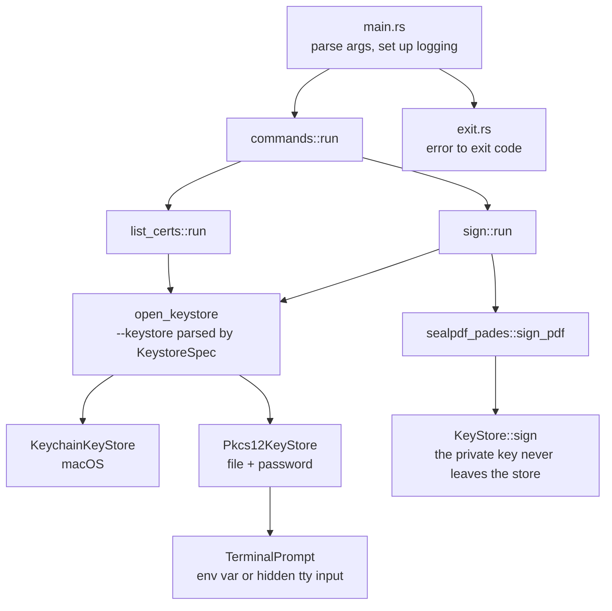
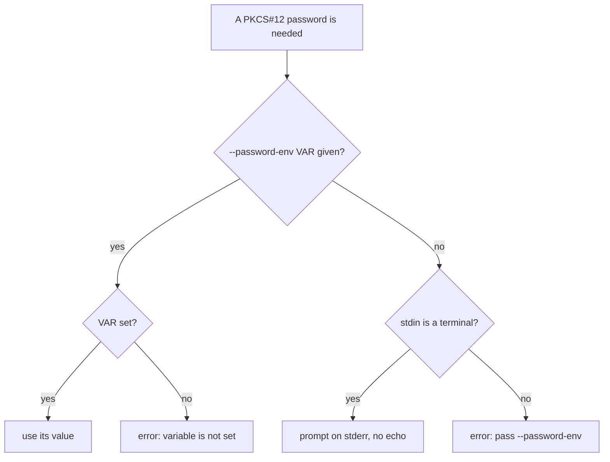

# SealPDF CLI

`sealpdf` (SealPDF) signs PDF files with a digital certificate you already have. The signature is invisible and follows PAdES (`adbe.pkcs7.detached`). The crate is `src/cli`; the binary is `sealpdf`.

| Command | What it does | Page |
| --- | --- | --- |
| `list-certs` | Shows the signing certificates a key store offers. | [list-certs.md](list-certs.md) |
| `sign` | Signs a PDF and writes a new file. | [sign.md](sign.md) |

Global option: `--verbose` prints debug lines on stderr. It never prints passwords or keys.

## Structure

| File | Role |
| --- | --- |
| `args.rs` | `clap` definitions and `KeystoreSpec` (`--keystore` parsing). |
| `commands/mod.rs` | Dispatch, `open_keystore`, and the default certificate filter. |
| `commands/list_certs.rs` | The table printed by `list-certs`. |
| `commands/sign.rs` | Output checks, certificate choice, signing, atomic write. |
| `prompt.rs` | `TerminalPrompt`: where passwords come from. |
| `exit.rs` | The only place that maps errors to exit codes. |

## Key stores

`--keystore TYPE[:LOCATION]` is shared by both commands.

| Value | Meaning |
| --- | --- |
| `keychain` | The macOS Keychain. Default on macOS; on other systems `--keystore` is required. Takes no location. |
| `pkcs12:<file>` | A `.p12` file. Everything after the first `:` is the path, so `pkcs12:C:\certs\me.p12` works. |

Any other value is a usage error (exit 2) that lists the supported types.

## Password handling

- The password is never accepted as an argument; only the *name* of a variable is.
- Nothing is cached: every request asks again.
- The Keychain asks through macOS itself; `sealpdf` never sees that secret.

## Exit codes

| Code | Constant | Meaning |
| --- | --- | --- |
| 0 | `OK` | Success. |
| 2 | `USAGE` | Wrong use: bad `--keystore`, output exists without `--force`, output is the input, several certificates and no terminal. Also what `clap` exits with. |
| 3 | `REFUSED` | The PDF was turned away before signing: encrypted, certified, no pages, or unreadable. |
| 4 | `KEYSTORE` | Key store, password or key access problem, including an unknown alias. |
| 6 | `OTHER` | Anything else (I/O, signature too large, unsupported algorithm). |

Errors print as `sealpdf: <message>` on stderr.

## Safety guarantees

- The input file is never modified or overwritten, even with `--force`.
- An existing output is replaced only with `--force`.
- The output is written to a temporary file and renamed, so a failure never leaves a partial PDF.
- Checks that need no certificate run before any password prompt.
- Signing an already signed PDF appends one more revision; earlier signatures stay valid.
- Encrypted and certified PDFs are refused, with nothing written.
- No network access: signing is local.
