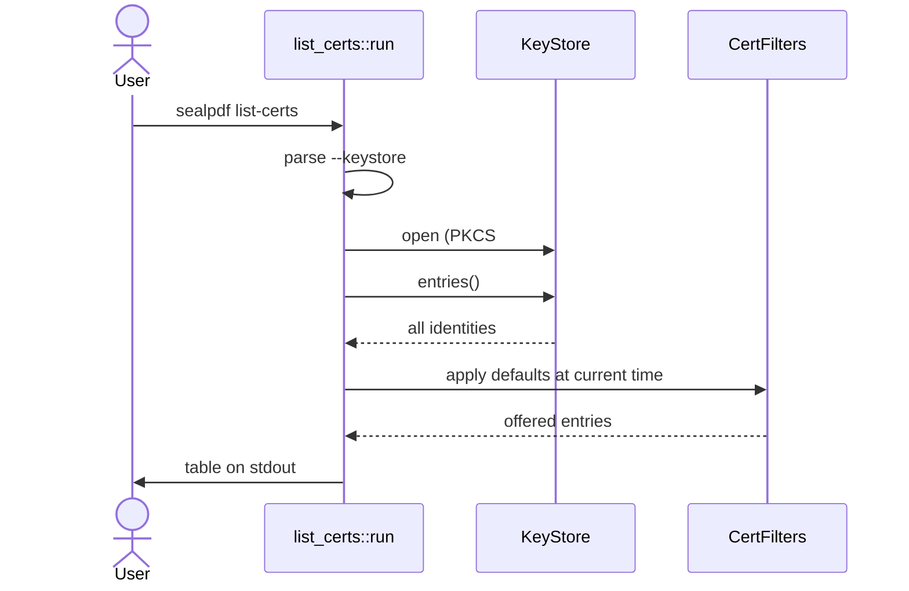

# `sealpdf list-certs`

Shows the signing certificates a key store offers, so you can pick an alias for `sign --alias`.

```
sealpdf list-certs [--keystore TYPE[:LOCATION]] [--password-env VAR]
```

| Option | Meaning |
| --- | --- |
| `--keystore` | `keychain` (macOS default) or `pkcs12:<file>`. See [the key stores](README.md#key-stores). |
| `--password-env` | Read the PKCS#12 password from this environment variable instead of asking. |

## Output

A table on stdout:

```
ALIAS         SUBJECT       ISSUER      SERIAL  VALID
Ada Lovelace  Ada Lovelace  Test CA     01A2    2026-01-01 to 2027-01-01
```

- `SUBJECT` and `ISSUER` are the common names (CN).
- `SERIAL` is hexadecimal.
- `VALID` is the validity period in UTC dates.
- A certificate that cannot be parsed is listed with empty columns rather than hidden.
- With nothing to show, `No signing certificates found.` goes to stderr and the exit code is 0.

## How it works



Default filters:

| Filter | Default | Effect |
| --- | --- | --- |
| `show_expired` | off | Expired and not-yet-valid certificates are hidden. |
| `only_signature` | off | No `nonRepudiation` requirement. |
| `only_alias` | off | Pseudonym restriction is not applied. |
| `skip_dnie_auth` | on | The authentication certificate of a Spanish DNIe is hidden. |

`sign --alias` ignores these filters, so a hidden certificate can still be used by naming it.

## Safety

Read-only. No private key is used and no file is written. Only the password prompt (PKCS#12) can read secrets, and it follows [the password rules](README.md#password-handling).
