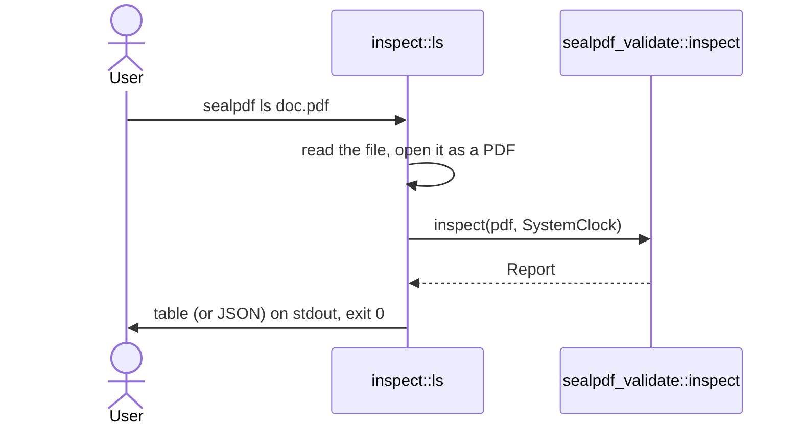

# `sealpdf ls`

Lists the signatures in a PDF, with whether each one is intact.

```
sealpdf ls [--json] <input.pdf>
```

| Option | Meaning |
| --- | --- |
| `--json` | Print the report as JSON on stdout instead of a table. |

It needs no key store and no password. It reports; it never decides: the exit code is 0 for a signed PDF, an unsigned one and a PDF with broken signatures alike. Use [`verify`](verify.md) to gate on the result.

## Output

```
#  FIELD       SIGNER    SIGNED AT             COVERS      STATUS
1  Signature1  Jane Doe  2026-10-20T14:03:00Z  rev 2 of 3  intact
2  Signature2  ACME Ltd  2026-10-21T09:11:00Z  rev 3 of 3  NO_MATCH_DATA
```

- `SIGNER` is the common name of the signer certificate. When the certificate cannot be read it is the name the signing application wrote in the file. A document timestamp shows `(document timestamp)`.
- `SIGNED AT` is the `/M` entry of the signature, written by the signer. It is a claim, not a proof, unless a timestamp backs it.
- `COVERS` is the revision of the file the signature covers. Only the last signature covers the whole file; in a co-signed PDF the earlier ones cover fewer revisions, which is normal.
- `STATUS` is `intact`, or the identifiers of what is wrong: `NO_MATCH_DATA` (the signed bytes changed or the signature value is wrong), `CORRUPTED_SIGN` (the signature cannot be read), `ALGORITHM_NOT_SUPPORTED`, `CERTIFICATE_EXPIRED` and `CERTIFICATE_NOT_VALID_YET`.
- `intact` does not mean trusted. Whether the certificate's issuer is trusted, and whether it was revoked, are not checked.
- A PDF without signatures prints `No signatures.`

## `--json`

The same report that [`verify --json`](verify.md#json) prints, with the same fields.

## Exit codes

| Code | When |
| --- | --- |
| 0 | The PDF was read, whatever its signatures hold. |
| 2 | The command was used wrongly, for example no file was given. |
| 3 | The file is not a readable PDF, or it is encrypted. |
| 6 | The file cannot be read from disk. |

## How it works



## Safety

Read-only: the file is read and nothing is written. No network access.
