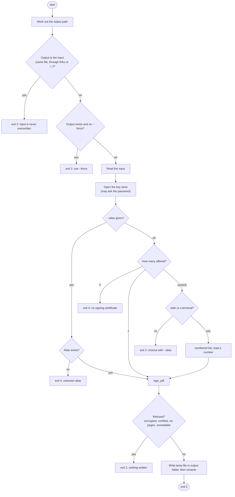
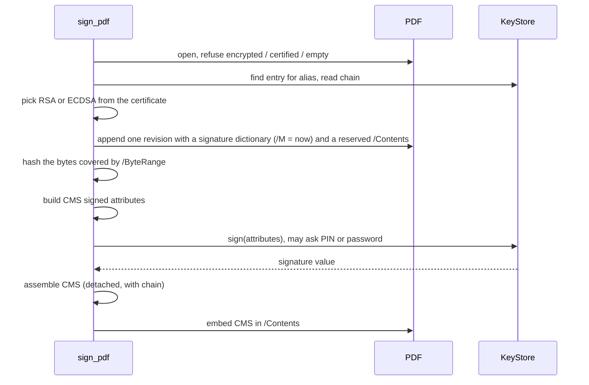

# `certsign sign`

Signs a PDF with an invisible PAdES signature and writes the result to a new file.

```
certsign sign <INPUT> [--keystore TYPE[:LOCATION]] [--password-env VAR]
                      [--alias NAME] [-o, --output FILE] [--force]
```

| Option | Meaning |
| --- | --- |
| `INPUT` | The PDF to sign. |
| `--keystore`, `--password-env` | As in [list-certs](list-certs.md). |
| `--alias` | Sign with this certificate. It need not pass the default filters but must exist. |
| `-o, --output` | Output path. Default: `<name>_signed.pdf` next to the input (`a.b.pdf` gives `a.b_signed.pdf`). |
| `--force` | Replace the output if it exists. |

On success it prints `Signed <input> -> <output>` on stderr.

## Flow



## What `sign_pdf` does



- The signature is an incremental update: the original bytes are untouched and earlier signatures stay valid.
- It has no appearance: pages are not changed. The field is attached to page 1.
- The private key stays in the key store; only the hash-bound attributes are sent to it.

## Safety

| Risk | Protection |
| --- | --- |
| Losing the original | The input is never the output, even through symlinks or `./..` paths, and `--force` does not change that. |
| Overwriting another file | Needs `--force`. |
| Half-written output | Temp file in the same folder, then rename; `--force` replaces, otherwise the rename refuses to clobber. |
| Password leak | Never an argument, never logged, never cached. See [password handling](README.md#password-handling). |
| Wasted prompts | Output and input checks run before any certificate or password is requested. |
| Unsafe documents | Encrypted and certified (no-changes) PDFs are refused. |
| Wrong certificate | With several, a non-interactive run fails and lists the aliases instead of guessing. |

Exit codes: see [the table](README.md#exit-codes).
